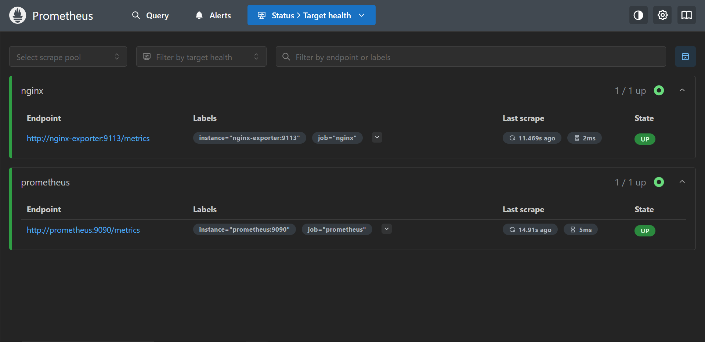
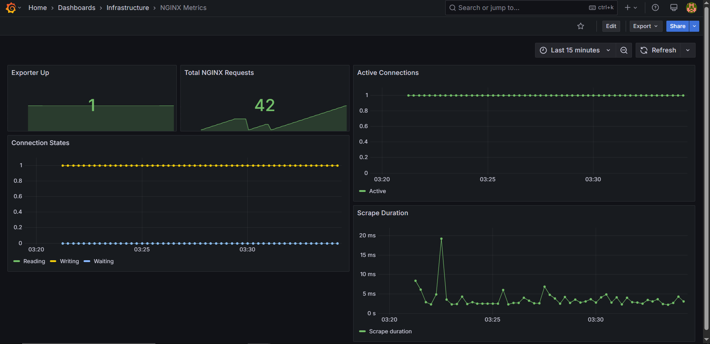

DevOps intern final assemsnet


## Task 2 — Linux Scripting

The repository includes two executable Bash scripts.

- `scripts/sysinfo.sh` reports the current user, effective UID, hostname, kernel release, ISO-8601 date, disk usage, memory usage, and Docker daemon status.
- `scripts/healthcheck.sh` checks a target URL for HTTP 200. Its default URL is `http://localhost:8080`.

### Validation

Run ShellCheck:

```bash
shellcheck scripts/sysinfo.sh scripts/healthcheck.sh
```

Run the system information report:

```bash
./scripts/sysinfo.sh
```

Check the application:

```bash
./scripts/healthcheck.sh
./scripts/healthcheck.sh http://localhost:8080/healthz
```

Both scripts are tracked as executable files in Git. Sample output should be recorded from the actual environment used for validation.


## Task 3 — Containerisation

A static HTML application served by NGINX on port `8080`. The container uses a pinned base-image tag, runs as a non-root user, injects a build identifier, and provides a `/healthz` endpoint.

### Build and run

From the repository root:

```bash
docker build --build-arg BUILD_SHA=local-test -t devops-intern-final:local ./app
docker run -d --name devops-test -p 8080:8080 devops-intern-final:local
```

The image built successfully and the container started.

### Verification

```bash
curl -i http://localhost:8080/healthz
```

**Observed:** HTTP `200`, body `healthy`.

```bash
docker inspect --format='{{.State.Health.Status}}' devops-test
```

**Observed:** `healthy`.

The home page loaded successfully, the build identifier was replaced with `local-test`, and the container ran as a non-root user.

### Image size

```bash
docker image inspect --format='{{.Size}}' devops-intern-final:local
docker image ls devops-intern-final:local
```

**Observed results:**
- Image metadata size: `20,979,993` bytes.
- `docker image ls` displayed disk usage of `73.7MB`.

The image-size requirement of under 60 MB still needs verification against the assessment's expected measurement.

### Status

- [x] Image builds and runs.
- [x] Application and health endpoint verified.
- [x] Build identifier injected.
- [x] Non-root runtime verified.
- [ ] Resolve the image-size requirement.

## Task 4 — CI Pipeline

The GitHub Actions workflow runs on pushes and pull requests targeting main.

1. Lint

ShellCheck analyzes shell scripts in scripts/.

Hadolint checks app/Dockerfile.

2. Build

Builds the Docker image.

Passes the Git commit SHA as a build argument.

Saves the image as a TAR archive.

Uploads the archive as a workflow artifact.

3. Test

Downloads and loads the image built by the previous job.

Starts the container and maps port 8080.

Retries the application health check until the service responds or the timeout is reached.

Verifies the /healthz endpoint.

Removes the test container, including when the job fails.

4. Publish

Publishing runs only after the lint, build, and test jobs succeed, and only for pushes to main.

Authenticates to GHCR using the automatically provided GITHUB_TOKEN.

Tags the existing image with the commit SHA and latest.

Pushes both tags to the registry.

Image reuse: The Docker image is built once and transferred between jobs using a workflow artifact. The test and publish jobs reuse that same image rather than rebuilding it, ensuring the published image is the one that was tested.

Container Registry

After a successful push to main, the image is published to:

ghcr.io/<owner>/<repository>:<commit-sha>
ghcr.io/<owner>/<repository>:latest
```

The repository path is converted to lowercase before tagging and pushing.

Publishing requires the workflow's `packages: write` permission and appropriate GHCR package access. The `GITHUB_TOKEN` is supplied by GitHub Actions and does not need to be hard-coded into the repository.


## Task 5 — Nomad Deployment

### Configuration

The NGINX application is deployed as a Nomad service job using the Docker driver and an image hosted on GitHub Container Registry (GHCR).

- **Job:** `nginx-app`
- **Task group:** `nginx`, with one allocation
- **Image tag:** `33c0c9592779f5475fd047cb65d7972f761ab136`
- **Resources:** 100 MHz CPU and 64 MB memory
- **Networking:** dynamically assigned host port mapped to container port `8080`
- **Service discovery:** registered with Consul as `nginx-app`
- **Health check:** HTTP `GET /healthz` every 10 seconds, with a 2-second timeout
- **Deployment strategy:** one task updated at a time, a 10-second minimum healthy period, a 2-minute healthy deadline, and automatic rollback enabled
- **Recovery:** restart and rescheduling policies configured

### Validate the Job

```bash
nomad job validate nomad/nginx-app.nomad.hcl
```

### Plan the Deployment

```bash
nomad job plan \
  -var="image_tag=33c0c9592779f5475fd047cb65d7972f761ab136" \
  nomad/nginx-app.nomad.hcl
```

Observed result:

```text
Job: "nginx-app"
Task Group: "nginx" (1 ignore)
  Task: "nginx"

Scheduler dry-run:
- All tasks successfully allocated.
```

### Run the Job

```bash
nomad job run \
  -var="image_tag=33c0c9592779f5475fd047cb65d7972f761ab136" \
  nomad/nginx-app.nomad.hcl
```

### Verify Deployment Status

```bash
nomad job status nginx-app
nomad job allocs nginx-app
```

Observed deployment status:

```text
Status        = running
Latest Deployment Status = successful

Task Group  Desired  Placed  Healthy  Unhealthy
nginx       1        1       1        0

Allocation:
4eab0b2d  nginx  run  running
```

### Verify Application Health

The running application was tested through its dynamically assigned host port:

```bash
curl -i http://127.0.0.1:30736/healthz
```

Observed response:

```text
HTTP/1.1 200 OK
Server: nginx/1.27.5
Content-Type: text/plain
Content-Length: 8

healthy
```

The deployment completed successfully with one running, healthy allocation, and the application health endpoint returned HTTP 200.

## Task 6 — Log Aggregation with Loki

Implemented a Docker Compose monitoring stack with Loki, Promtail, and Grafana.

- Loki stores and exposes logs for querying.
- Promtail discovers Docker containers and forwards logs to Loki.
- Grafana Explore provides LogQL-based log queries.
- Verified labels: `container`, `job`, `service`, and `nomad_alloc_id`.

### Start the Stack

```bash
docker compose -f monitoring/docker-compose.yaml config
docker compose -f monitoring/docker-compose.yaml up -d
docker compose -f monitoring/docker-compose.yaml ps
curl -i http://localhost:3100/ready
```

### Query Logs

In Grafana Explore, select Loki, use Code mode, and run:

```logql
{container=~".+"}
```

To find the test request:

```logql
{container=~".+"} |= "/task6-test-not-found"
```

The test request was generated against the NGINX application using `/task6-test-not-found`. The required log labels were verified in Grafana Explore.

Detailed setup, queries, and troubleshooting: [`monitoring/loki_setup.md`](monitoring/loki_setup.md).

Screenshot evidence: [`docs/screenshots/loki-404-query.png`](docs/screenshots/loki-404-query.png).


## Metrics Stack

The `metrics/` directory contains a Docker Compose stack for collecting and visualizing NGINX metrics using the NGINX Prometheus Exporter, Prometheus, and Grafana.

Start the stack from the repository root:

```bash
docker compose -f metrics/docker-compose.yaml up -d --build
```

Access the services:

- **Prometheus:** http://localhost:8624
- **Grafana:** http://localhost:3001 (local credentials: `admin` / `admin`)

Prometheus scrapes NGINX exporter metrics every 15 seconds. Grafana loads the provisioned dashboard from `metrics/grafana/dashboards/nginx-metrics.json`.

### Metrics Screenshots

**Prometheus — Scrape Targets**



**Grafana — NGINX Metrics Dashboard**




See [`metrics/README.md`](metrics/README.md) for architecture, configuration, verification commands, and troubleshooting.
-