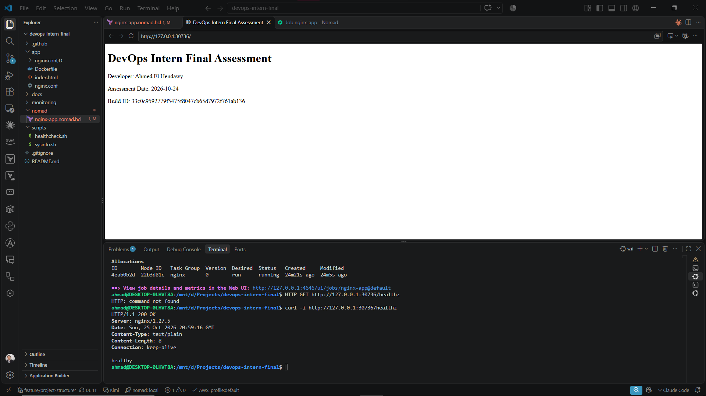
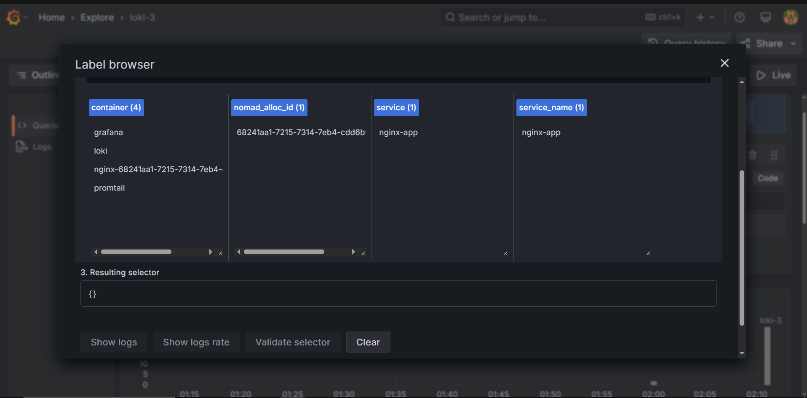
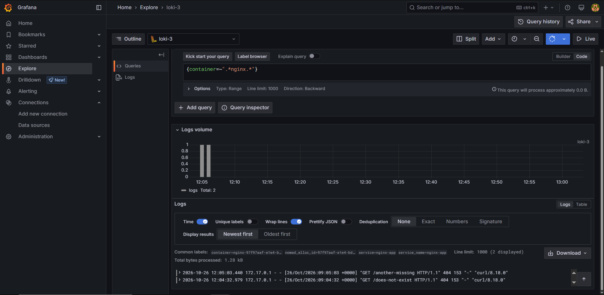
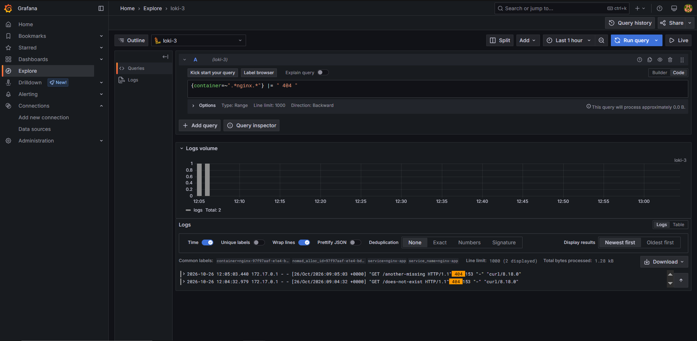
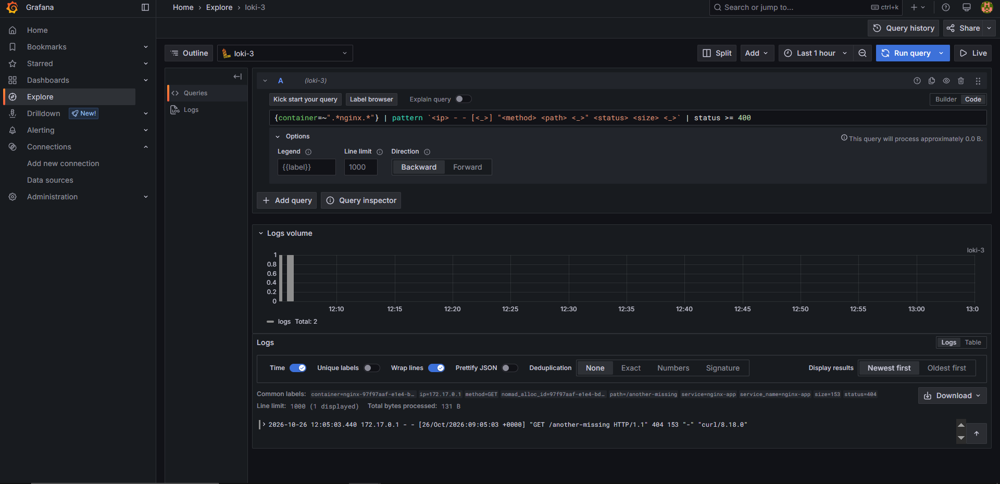

# DevOps Intern Final Assessment

[](https://github.com/Ahmad-Hamdy-Elhendawy/devops-intern-final/actions/workflows/ci.yml)

**Developer:** Ahmed El Hendawy
**Submission date:** 2026-10-26

An end-to-end pipeline for a containerised NGINX application: source control, Linux scripts, a hardened image, GitHub Actions CI, a HashiCorp Nomad deployment, and log aggregation with Grafana Loki. A Prometheus and Grafana metrics stack is included as the optional extension.

## Repository layout

```
.
├── .github/workflows/ci.yml        # GitHub Actions pipeline
├── app/                            # Dockerfile, nginx.conf, index.html
├── docs/screenshots/               # Evidence screenshots
├── metrics/                        # Extension: Prometheus + Grafana metrics stack
├── monitoring/                     # Loki, Promtail, Grafana log stack
├── nomad/                          # Nomad job specification
└── scripts/                        # sysinfo.sh, healthcheck.sh
```

## Prerequisites

| Tool | Version |
|---|---|
| Docker | 29.4.3 |
| Docker Compose | v5.1.3 |
| Nomad | v2.0.7 |
| Consul | v2.1.0 |
| ShellCheck | v0.11.0 (latest release; CI runs it through `ludeeus/action-shellcheck@2.0.0`) |
| Hadolint | v2.15.0 (latest release; CI runs it through `hadolint/hadolint-action@v3.1.0`) |
| Bash, curl | any recent version |

Run all commands from the repository root.

## Architecture

```
 Source (feature/* branch, pull request)
        |
        v
 GitHub Actions:  lint -> build -> test -> publish
        |
        v
 GHCR image  (:<commit-sha>, :latest)
        |
        v
 Nomad (docker driver) + Consul service and health check
        |
        +--> NGINX access logs --> Promtail --> Loki --> Grafana
        |
        +--> /stub_status --> nginx-prometheus-exporter --> Prometheus --> Grafana   (extension)
```

The CI build job produces a single image artifact. The test and publish jobs load that same artifact, so the image pushed to GHCR is the one that passed the health check.

## Quick Start

Docker must be running. There are two ways to get the application up; each takes fewer than ten commands.

### Option A: Docker only

```sh
git clone https://github.com/Ahmad-Hamdy-Elhendawy/devops-intern-final.git
cd devops-intern-final
docker build --build-arg BUILD_SHA=local-test -t devops-intern-final:local ./app
docker run -d --name devops-test -p 8080:8080 devops-intern-final:local
curl -i http://localhost:8080/
curl -i http://localhost:8080/healthz
./scripts/healthcheck.sh
docker rm -f devops-test
```

Expected: HTTP 200 on both URLs, the `/healthz` body is `healthy`, and `healthcheck.sh` exits 0.

### Option B: Consul and Nomad (the deployed pipeline)

This pulls the image that CI published to GHCR and runs it as a Nomad job registered in Consul. Start the two agents first, each in its own terminal, and leave them running:

```sh
# terminal 1
consul agent -dev

# terminal 2
nomad agent -dev
```

Then, in a third terminal:

```sh
git clone https://github.com/Ahmad-Hamdy-Elhendawy/devops-intern-final.git
cd devops-intern-final
nomad job run nomad/nginx-app.nomad.hcl
nomad job status nginx-app
PORT=$(curl -s http://127.0.0.1:8500/v1/catalog/service/nginx-app | grep -o '"ServicePort":[0-9]*' | cut -d: -f2)
curl -i http://127.0.0.1:$PORT/healthz
./scripts/healthcheck.sh http://127.0.0.1:$PORT/healthz
```

Expected: the allocation shows `running` and healthy in `nomad job status`, and both checks return HTTP 200 with the body `healthy`. The port is dynamic, so it is read from Consul's service catalog (the Nomad UI at `http://127.0.0.1:4646` shows it too).

To deploy a specific image, pass its tag: `nomad job run -var="image_tag=<commit-sha>" nomad/nginx-app.nomad.hcl`.

Clean up with `nomad job stop -purge nginx-app`, then stop both agents with Ctrl+C. The GHCR package must be public, otherwise run `docker login ghcr.io` first.

## Task 1 — Source control

The repository is public: [Ahmad-Hamdy-Elhendawy/devops-intern-final](https://github.com/Ahmad-Hamdy-Elhendawy/devops-intern-final). Work was done in small commits using conventional prefixes (`feat`, `fix`, `docs`, `ci`). IDE metadata and secrets are excluded by `.gitignore`.

- PR [#5](https://github.com/Ahmad-Hamdy-Elhendawy/devops-intern-final/pull/5): `feature/project-structure` merged into `main`.
- PR [#7](https://github.com/Ahmad-Hamdy-Elhendawy/devops-intern-final/pull/7): `fix/script-exec-bit` merged into `main` (executable bit on the scripts, see Troubleshooting).
- Each PR carries a description and a self-review comment.
- The final state is tagged `v1.0.0`.

Inspect the history with:

```sh
git log --oneline --decorate --graph --all
git tag --list
```

## Task 2 — Linux scripting

- `scripts/sysinfo.sh` prints the current user and effective UID, hostname, kernel release, ISO-8601 date, disk usage, memory usage, and Docker daemon status. It falls back to `/proc/meminfo` when `free` is unavailable.
- `scripts/healthcheck.sh [URL]` requests a URL (default `http://localhost:8080`) and asserts HTTP 200. It uses a 5 s connect timeout and a 10 s total timeout. It exits 0 on success and non-zero with a diagnostic otherwise.

Both scripts are committed with mode `100755`:

```sh
git ls-files -s scripts/
shellcheck scripts/sysinfo.sh scripts/healthcheck.sh
```

`shellcheck` exits 0 with no output.

Sample `sysinfo.sh` output (WSL2, 2026-10-26):

```
=== System Information ===
Current user: ahmad
Effective UID: 1000
Hostname: DESKTOP-0LHVT8A
Kernel release: 6.18.54.1-microsoft-standard-WSL2
System date: 2026-10-26T05:00:19+03:00

=== Disk Usage ===
Filesystem      Size  Used Avail Use% Mounted on
/dev/sdd       1007G  1.9G   954G   1% /
C:\             266G  221G    45G  84% /mnt/c
D:\             211G  165G    47G  79% /mnt/d

=== Memory Usage ===
               total        used        free      shared  buff/cache   available
Mem:           7.7Gi       720Mi       6.8Gi       5.0Mi       314Mi       7.0Gi
Swap:          2.0Gi          0B       2.0Gi

=== Docker Daemon ===
Docker status: Docker CLI not installed.
```

Docker was not installed in that WSL2 environment, so the script exited non-zero. That is the intended behaviour of `sysinfo.sh` when Docker is unavailable.

Sample `healthcheck.sh` output against a running container:

```
PASS: http://127.0.0.1:24329/healthz returned HTTP 200
```

## Task 3 — Containerisation

`app/Dockerfile` builds a small static-site image:

- Base image pinned to `nginx:1.27-alpine-slim` (no `latest`).
- Custom `app/nginx.conf` serves the site on port 8080 and exposes `/healthz`, returning 200 with the body `healthy`.
- Runs as the non-root user `appuser`, with PID and temp paths under `/tmp`.
- `EXPOSE 8080` and a `HEALTHCHECK` against `/healthz`.
- `BUILD_SHA` build argument, written into the served page and the `org.opencontainers.image.revision` label.
- `/stub_status` is exposed for the metrics exporter.

Build and run:

```sh
docker build --build-arg BUILD_SHA=local-test -t devops-intern-final:local ./app
docker run -d --name devops-test -p 8080:8080 devops-intern-final:local
```

Image size (`docker images devops-intern-final:local`):

```
IMAGE                       ID             DISK USAGE   CONTENT SIZE   EXTRA
devops-intern-final:local   4b962a646a3f       19.5MB         5.45MB
```

Both the unpacked size (19.5 MB) and the compressed content size (5.45 MB) are under the 60 MB limit.

Output of `curl` against both endpoints (captured from the running Nomad allocation on dynamic port 31632):

```
$ curl -i http://127.0.0.1:31632/
HTTP/1.1 200 OK
Server: nginx/1.27.5
Content-Type: text/html
Content-Length: 473

<h1>DevOps Intern Final Assessment</h1>
<p>Developer: Ahmed El Hendawy</p>
<p>Assessment Date: 2026-10-24</p>
<p>Build ID: 33c0c9592779f5475fd047cb65d7972f761ab136</p>

$ curl -i http://127.0.0.1:31632/healthz
HTTP/1.1 200 OK
Server: nginx/1.27.5
Content-Type: text/plain
Content-Length: 8

healthy
```

Container health and runtime user:

```
$ docker inspect --format='{{.State.Health.Status}} {{.Config.User}}' <container>
healthy appuser
```

## Task 4 — Continuous Integration

`.github/workflows/ci.yml` runs on pushes and pull requests targeting `main`.

| Job | What it does |
|---|---|
| `lint` | ShellCheck on `scripts/`, Hadolint on `app/Dockerfile` |
| `build` | Builds the image with `BUILD_SHA=${{ github.sha }}`, saves it as the `nginx-image` artifact (1-day retention) |
| `test` | Loads the artifact, starts the container, waits for readiness (up to 20 tries, 2 s apart), then runs `./scripts/healthcheck.sh` against `/` and `/healthz`; the job fails if either is not 200 |
| `publish` | Runs only on a push to `main`, after the other jobs pass; pushes the same image to GHCR tagged `<commit-sha>` and `latest` |

Details:

- Actions are pinned to a version: `actions/checkout@v4`, `ludeeus/action-shellcheck@2.0.0`, `hadolint/hadolint-action@v3.1.0`.
- Permissions default to `contents: read`; only the publish job adds `packages: write`. Authentication uses the built-in `GITHUB_TOKEN`, so no credentials are stored in the repository.
- The GHCR image name is lowercased from `github.repository`.
- The published image is the artifact that passed `test`, not a rebuild.

## Task 5 — Nomad deployment

`nomad/nginx-app.nomad.hcl` defines the `nginx-app` job:

- `type = "service"`, one group, one task, `docker` driver.
- Image `ghcr.io/ahmad-hamdy-elhendawy/devops-intern-final:${var.image_tag}`, with `image_tag` as an HCL variable.
- 100 MHz CPU and 64 MB memory (no deviation).
- Dynamic port named `http` mapped to container port 8080.
- Consul service `nginx-app` with an HTTP check on `/healthz` (interval 10 s, timeout 2 s).
- `update` stanza: `max_parallel = 1`, `min_healthy_time = 10s`, `healthy_deadline = 2m`, `auto_revert = true`.
- `restart` and `reschedule` policies.

```sh
nomad job validate nomad/nginx-app.nomad.hcl
nomad job plan -var="image_tag=<commit-sha>" nomad/nginx-app.nomad.hcl
nomad job run  -var="image_tag=<commit-sha>" nomad/nginx-app.nomad.hcl
nomad job status nginx-app
```

Observed output (Nomad v2.0.7):

```
Job validation successful
```

```
Job: "nginx-app"
Task Group: "nginx" (1 ignore)
  Task: "nginx"

Scheduler dry-run:
- All tasks successfully allocated.
```

```
Deployment "e686c357" successful
Job ID       = nginx-app
Job Version  = 6
Status       = successful
Desired      Placed  Healthy  Unhealthy
1            1       1        0
```

```
Type          = service
Status        = running
Latest Deployment
Status        = successful
Task Group  Auto Revert  Desired  Placed  Healthy  Unhealthy
nginx       true         1        1       1        0
```

The final allocation was `97f97aaf` on node `0fe4d2bf`, serving traffic on its dynamic port (see the curl output in Task 3).

The screenshot below shows a running allocation, the page served on its dynamic port (name, assessment date and build identifier), and `curl -i` against `/healthz` returning 200:



## Task 6 — Log aggregation with Loki

The `monitoring/` Compose stack runs Loki 3.5.0 (port 3100), Promtail 3.5.0 and Grafana 11.6.0 (port 3000). `loki-config.yaml` and `promtail-config.yaml` are committed. Promtail discovers containers through the read-only Docker socket and attaches the labels `job`, `container`, `service` (`nginx-app`) and `nomad_alloc_id`.

```sh
docker compose -f monitoring/docker-compose.yaml up -d
docker compose -f monitoring/docker-compose.yaml ps
curl -i http://localhost:3100/ready
```

In Grafana (`http://localhost:3000`), add a Loki data source with the URL `http://loki:3100`, then open Explore in Code mode. Generate traffic, including requests for missing paths:

```sh
curl -i http://127.0.0.1:8080/
curl -i http://127.0.0.1:8080/does-not-exist
curl -i http://127.0.0.1:8080/another-missing
```

Queries and results:

```logql
{container=~".*nginx.*"}
{container=~".*nginx.*"} |= " 404 "
```

```
172.17.0.1 - - [26/Oct/2026:02:33:47 +0000] "GET / HTTP/1.1" 200 473 "-" "curl/8.18.0"
172.17.0.1 - - [26/Oct/2026:09:04:32 +0000] "GET /does-not-exist HTTP/1.1" 404 153 "-" "curl/8.18.0"
172.17.0.1 - - [26/Oct/2026:09:05:03 +0000] "GET /another-missing HTTP/1.1" 404 153 "-" "curl/8.18.0"
```

The first query returns all NGINX access logs; the second isolates the 404 responses.

The Label browser shows the labels attached to the logs (`container`, `nomad_alloc_id`, `service`, `service_name`):



All NGINX access logs, selected by container name:



Only the 404 responses, using a line filter (the `404` is highlighted):



Non-200 responses isolated by parsing the status code with a `pattern` expression and filtering `status >= 400`:

```logql
{container=~".*nginx.*"} | pattern `<ip> - - [<_>] "<method> <path> <_>" <status> <size> <_>` | status >= 400
```



Setup notes and problems are recorded in [`monitoring/loki_setup.md`](monitoring/loki_setup.md).

```sh
docker compose -f monitoring/docker-compose.yaml down
```

## Optional extension — Metrics

The `metrics/` stack exposes NGINX metrics with `nginx-prometheus-exporter`, scrapes them with Prometheus, and shows them in a provisioned Grafana dashboard.

```
NGINX :8080/stub_status -> nginx-prometheus-exporter :9113 -> Prometheus :9090 -> Grafana :3000
```

Prometheus is published on host port 8624 and Grafana on 3001 (to avoid clashing with the Loki stack). Prometheus scrapes every 15 s.

```sh
docker compose -f metrics/docker-compose.yaml up -d --build
docker compose -f metrics/docker-compose.yaml ps
```

Useful queries: `up{job="nginx"}`, `nginx_http_requests_total`, `nginx_connections_active`. See [`metrics/README.md`](metrics/README.md) for details.


```sh
docker compose -f metrics/docker-compose.yaml down
```

## Troubleshooting

Failures I hit while building this:

**Grafana could not query Loki: `unsupported protocol scheme ""`.**
The data source URL was missing its scheme. Grafana runs inside the Compose network, so the correct URL is `http://loki:3100` (not `localhost`). Fixed by editing the data source and clicking "Save & test".

**GHCR publish failed: `invalid reference format`.**
The repository owner name contains uppercase letters, and Docker image references must be lowercase. The workflow now lowercases the full image name before tagging and pushing:

```sh
IMAGE="ghcr.io/$(echo "$REPOSITORY" | tr '[:upper:]' '[:lower:]')"
```

**CI test job failed: `./scripts/healthcheck.sh: Permission denied`.**
The scripts had been committed with mode `100644`. As a workaround CI temporarily called `bash ./scripts/healthcheck.sh`. The proper fix (PR #7) was `git update-index --chmod=+x scripts/*.sh`, so both scripts are now `100755` and the workflow calls them directly. Verify with `git ls-files -s scripts/`.

**Loki root URL returned 404.**
Not a failure: `/` is not a readiness endpoint. Use `curl -i http://localhost:3100/ready`.

## Known Limitations

- No TLS in front of the application.
- `latest` is also published to GHCR; the Nomad job deploys by commit SHA, but the extra tag is not production practice.
- The production image exposes `/stub_status` for the metrics exporter. It should be restricted to the internal network or removed.
- Promtail mounts the Docker socket, which gives it broad access to the host.
- Loki and Grafana run without authentication hardening or retention policies, and Grafana uses the default `admin` / `admin` credentials (local use only).
- The Nomad job runs a single allocation on a single-node setup, and the Promtail `service` label is hard-coded to `nginx-app`.
- The Nomad job's default `image_tag` points to a commit SHA that predates the switch to the slim base image.

With more time I would add TLS with a reverse proxy, restrict `/stub_status`, run Nomad and Consul on multiple nodes, and add authentication and retention to the monitoring stack.
